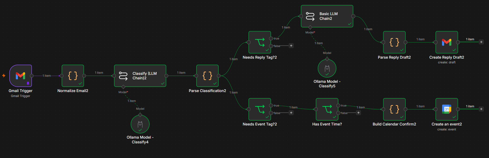

# n8n Email Assistant

An n8n workflow that uses Gmail and a local Ollama model to classify incoming email, create reply drafts, and add scheduled events to Google Calendar.

## Workflow Overview



## Features

- Reads the complete Gmail message body instead of only the Gmail snippet.
- Classifies messages with these tags:
  - `job_search`
  - `response_needed`
  - `skippable`
  - `event`
  - `application_update`
  - `offer_related`
- Creates a reply draft addressed to the original sender.
- Keeps reply drafts in the original Gmail thread.
- Extracts event details from classified email.
- Creates calendar events only when a confirmed event time is available.
- Uses a one-hour default duration when an event has a start time but no end time.
- Uses Hong Kong time (`Asia/Hong_Kong`) for calendar events.
- Uses Ollama locally through n8n.

## Files

- `Email tool v2.public.json` - sanitized n8n workflow export for sharing or importing.
- `docker-compose.yml` - local n8n, sandbox, and runner services.
- `.env.example` - environment variable template with placeholders.
- `.gitignore` - prevents local secrets and private workflow exports from being committed.

## Requirements

- Docker Desktop
- n8n
- Gmail OAuth access
- Google Calendar OAuth access
- Ollama running locally
- A compatible Ollama model, such as `qwen3.5:4b`

## Setup

1. Copy the environment template:

   ```powershell
   Copy-Item .env.example .env
   ```

2. Edit `.env` and replace every placeholder with local values.

3. Start the services:

   ```powershell
   docker compose up -d
   ```

4. Open n8n at:

   ```text
   http://localhost:5678
   ```

5. Import `Email tool v2.public.json` into n8n.

6. Create or select the required credentials:

   - Gmail OAuth2
   - Google Calendar OAuth2
   - Ollama

7. Replace `YOUR_GOOGLE_CALENDAR_ID` in the imported calendar node with your calendar ID.

8. Test the workflow with pinned Gmail trigger data before activating it.

## Workflow

```text
Gmail Trigger
  -> Normalize Email
  -> Classify (LLM Chain)
  -> Parse Classification
  -> Needs Reply Tag?
       -> Basic LLM Chain
       -> Parse Reply Draft
       -> Create Reply Draft
  -> Needs Event Tag?
       -> Has Event Time?
       -> Build Calendar Confirm
       -> Create an event
```

Messages classified as events without a confirmed time stop at `Has Event Time?` and are not sent to Google Calendar.

## Security

Do not commit:

- `.env`
- OAuth tokens or credential exports
- API keys, passwords, or approval tokens
- Pinned Gmail data
- Private workflow exports

The public workflow removes credential metadata and pinned email data. After importing it into n8n, configure your own credentials locally.
